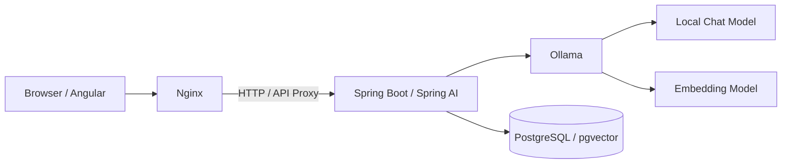

# DocChat — Local AI-Powered PDF Assistant


**DocChat is a locally hosted AI assistant that lets you upload PDF documents, explore their content, generate summaries, and ask questions using Retrieval-Augmented Generation (RAG).**

Instead of sending your documents to an external AI service, DocChat uses locally running AI models through Ollama, with PostgreSQL and pgvector for document storage and semantic retrieval.

No API keys. No cloud AI subscription. Your documents stay within your local environment.

---

## Overview

DocChat transforms PDF documents into an interactive workspace where you can understand, explore, and retrieve information without manually searching through pages.

Upload a document, wait for the analysis to finish, and start asking questions. DocChat retrieves relevant content from your document and uses it to generate contextual answers.


## Screenshots

| PDF Upload | Document Analysis |
|---|---|
|  |  |

| Desktop Workspace | Mobile Interface |
|---|---|
|  |  |

---

## Features

- **PDF Upload & Validation** — Validates PDF files, checks file signatures, sanitizes filenames, and enforces a 20 MB upload limit.
- **Automatic Document Summarization** — Generates a summary and key insights after document processing.
- **Contextual Question Answering** — Answers questions using information retrieved from the uploaded document.
- **Document-Grounded Responses** — When relevant information cannot be found, the assistant indicates that the information is not available in the document.
- **RAG-Based Retrieval** — Uses embeddings and vector similarity search to retrieve relevant passages.
- **Conversation Context** — Supports follow-up questions and contextual interactions.
- **Streaming Responses** — Answers are streamed progressively to the interface.
- **Prompt-Injection Protection** — Includes prompt defenses and pattern-based detection for English, French, and Arabic.
- **Local AI Processing** — Uses Ollama for local embedding generation and text generation.
- **Responsive Interface** — Designed for desktop and mobile devices, with keyboard accessibility in mind.
- **Containerized Deployment** — Start the application stack using Docker Compose.

---

## Architecture

DocChat follows a straightforward architecture that separates the frontend, backend, database, and AI infrastructure.



### Architecture Components

| Component | Responsibility |
|---|---|
| Angular | User interface, document workspace, chat, and streaming |
| Nginx | Static file serving, API proxying, security headers, and rate limiting |
| Spring Boot | REST API, document processing, retrieval, prompt management, and streaming |
| Spring AI | AI integration, document processing, embeddings, and retrieval workflows |
| Ollama | Local model execution |
| PostgreSQL | Persistent document and application data |
| pgvector | Vector storage and similarity search |
| Docker Compose | Container orchestration for the local environment |

---

## Technology Stack

| Category | Technologies |
|---|---|
| Frontend | Angular, TypeScript, Signals, Standalone Components, OnPush |
| Frontend Testing | Vitest |
| Backend | Java 21, Spring Boot 4.1, Spring AI 2.0 |
| Security & Validation | Spring Security 7, Bean Validation |
| API & Monitoring | REST APIs, NDJSON Streaming, Spring Actuator |
| Database | PostgreSQL 17, pgvector |
| Vector Search | HNSW, Cosine Similarity |
| AI | Ollama, Llama 3.2, Nomic Embed Text |
| Infrastructure | Docker, Docker Compose, Nginx |
| Build | Maven Wrapper |
| CI | GitHub Actions |

---

## Getting Started

The easiest way to run DocChat is through Docker Compose.

You don't need to install Java, Maven, Node.js, Angular, or PostgreSQL separately. Docker handles the application services.

### Prerequisites

Install the following:

| Requirement | Description | Download |
|---|---|---|
| Docker Desktop | Runs the containers and manages the environment | [Download Docker](https://www.docker.com/products/docker-desktop/) |
| Git | Clones the repository | [Download Git](https://git-scm.com/downloads) |

Verify your installation:

```bash
docker --version
docker compose version
git --version
```

### Recommended Hardware

| Resource | Minimum | Recommended |
|---|---|---|
| RAM | 8 GB | 16 GB or more |
| Disk Space | 10 GB free | 15 GB or more |
| CPU | Modern multi-core CPU | More cores for faster inference |
| GPU | Not required | Compatible GPU for faster inference |

<details>
<summary><strong>Configure Docker memory on Windows</strong></summary>

On Windows using Docker Desktop with WSL 2, you can configure memory through the `.wslconfig` file.

Create or edit:

`C:\Users\YOUR_USERNAME\.wslconfig`

```ini
[wsl2]
memory=8GB
```

Save the file and run the following command in PowerShell:

```powershell
wsl --shutdown
```

Restart Docker Desktop afterwards.

Adjust the memory allocation according to your system resources.

</details>

### 1. Clone the Repository

```bash
git clone https://github.com/devloperHicham/DocChat.git

cd DocChat
```

### 2. Configure Environment Variables

DocChat includes a `.env` file with the configuration required to start the application.

Review the file before starting the containers:

```env
POSTGRES_CHAT_DB=chat_db
POSTGRES_CHAT_USER=chat_user
POSTGRES_CHAT_PASSWORD=CHANGE_ME

POSTGRES_PORT=5432

PGADMIN_EMAIL=docchat@example.com
PGADMIN_PASSWORD=CHANGE_ME
PGADMIN_PORT=5050

CHAT_SERVICE_PORT=8080
FRONTEND_PORT=4200
```

You can change the passwords and ports according to your environment.

<details>
<summary><strong>Environment variables reference</strong></summary>

| Variable | Description | Default |
|---|---|---|
| `POSTGRES_CHAT_DB` | PostgreSQL database name | `chat_db` |
| `POSTGRES_CHAT_USER` | PostgreSQL username | `chat_user` |
| `POSTGRES_CHAT_PASSWORD` | PostgreSQL password | `CHANGE_ME` |
| `POSTGRES_PORT` | Database host port | `5432` |
| `PGADMIN_EMAIL` | pgAdmin login email | `docchat@example.com` |
| `PGADMIN_PASSWORD` | pgAdmin password | `CHANGE_ME` |
| `PGADMIN_PORT` | pgAdmin host port | `5050` |
| `CHAT_SERVICE_PORT` | Backend host port | `8080` |
| `FRONTEND_PORT` | Frontend host port | `4200` |

</details>

> **Security:** These credentials are intended for local development only. Do not use the default credentials in production or expose the services publicly.

### 3. Build and Start the Application

From the root directory:

```bash
docker compose up -d --build
```

Docker will build the frontend and backend images and start the required containers.

The first build may take several minutes depending on your internet connection and hardware.

### 4. Download the AI Models

DocChat uses two local models through Ollama.

Download the embedding model:

```bash
docker exec ollama ollama pull nomic-embed-text
```

Download the chat model:

```bash
docker exec ollama ollama pull llama3.2
```

| Model | Purpose |
|---|---|
| `nomic-embed-text` | Generates embeddings for document passages and questions |
| `llama3.2` | Generates summaries and conversational answers |

The model downloads are performed only once unless you remove the Ollama data volume.

### 5. Verify the Services

Check the running containers:

```bash
docker compose ps
```

Check backend health:

```bash
curl http://localhost:8080/actuator/health
```

Expected response:

```json
{
  "status": "UP"
}
```

The backend may need a little time to initialize.

### 6. Open DocChat

Open your browser:

**http://localhost:4200**

| Service | URL |
|---|---|
| DocChat Web Application | http://localhost:4200 |
| Backend API | http://localhost:8080 |
| PostgreSQL | `localhost:5432` |
| pgAdmin | http://localhost:5050 |

pgAdmin is included in the default Compose configuration. If you use the default configuration, it starts with the other containers.

---

## How to Use DocChat

1. Open the web application.
2. Upload a PDF document using drag and drop or the file selector.
3. Wait for the document analysis to complete.
4. Read the generated summary and key points.
5. Ask questions directly in the chat.
6. Continue the conversation with follow-up questions.
7. Use **New document** when you want to start another document.

### Example Questions

```text
Summarize this document.

What are the most important points?

Explain the main concepts in simple language.

What does the document say about security?

Give me more details about the previous answer.

What are the conclusions of this document?
```

If the requested information is not available in the document, DocChat is designed to indicate that rather than intentionally answering from unrelated knowledge.

---

## How DocChat Works

DocChat uses a Retrieval-Augmented Generation (RAG) workflow to connect user questions with the content of uploaded documents.

### Document Processing Pipeline

**1. PDF Validation**

The uploaded file is validated, including its file signature, size, and filename.

**2. Text Extraction**

Spring AI's `PagePdfDocumentReader` extracts text from the PDF pages.

**3. Text Chunking**

The extracted text is divided into smaller passages using `TokenTextSplitter`.

**4. Embedding Generation**

Ollama's `nomic-embed-text` model converts text passages into vector embeddings.

**5. Vector Storage**

The passages and their embeddings are stored in PostgreSQL using pgvector.

**6. Document Summary**

Relevant portions of the document are used to generate a summary and key points.

### Question Answering Pipeline

**1. Question Analysis**

The system analyzes the question to determine its type, including overview questions, specific questions, vague requests, and potentially blocked requests.

**2. Context Retrieval**

For smaller documents, the system can use broader document context. For larger documents, relevant passages are retrieved using vector similarity search.

**3. Context Preparation**

The retrieved passages and conversation context are prepared for the AI model.

**4. AI Generation**

The chat model receives the question and document context, with instructions to answer using the provided information.

**5. Streaming**

The generated response is streamed progressively to the frontend.

---

## Project Structure

```text
DocChat/
├── backend/
│   └── chat-service/
│       ├── src/
│       │   ├── main/
│       │   │   ├── java/
│       │   │   │   └── com/docchat/chat_service/
│       │   │   │       ├── config/
│       │   │   │       ├── security/
│       │   │   │       ├── filter/
│       │   │   │       ├── exception/
│       │   │   │       ├── utils/
│       │   │   │       ├── document/
│       │   │   │       └── chat/
│       │   │   └── resources/
│       │   └── test/
│       ├── Dockerfile
│       ├── pom.xml
│       └── mvnw
│
├── frontend/
│   ├── src/
│   │   └── app/
│   │       ├── core/
│   │       ├── layout/
│   │       ├── shared/
│   │       └── features/
│   ├── Dockerfile
│   └── nginx.conf
│
├── init-scripts/
│   └── chat.sql
│
├── docs/
│   ├── architecture.md
│   ├── api.md
│   └── images/
│
├── samples/
├── .github/
├── docker-compose.yml
├── docker-compose.dev.yml
├── .env
├── .gitignore
└── README.md
```

---

## Where to Explore the Code

| Area | File / Directory |
|---|---|
| Chat & RAG implementation | `backend/chat-service/.../chat/service/impl/ChatServiceImpl.java` |
| Question analysis | `backend/chat-service/.../chat/service/impl/QuestionAnalyzer.java` |
| PDF ingestion | `backend/chat-service/.../document/service/impl/IngestionServiceImpl.java` |
| Spring Security | `backend/chat-service/.../security/SecurityConfig.java` |
| Backend exception handling | `backend/chat-service/.../exception/GlobalExceptionHandler.java` |
| Angular workspace state | `frontend/src/app/features/workspace/workspace-store.ts` |
| Streaming & API communication | `frontend/src/app/core/document-api.ts` |
| Nginx configuration | `frontend/nginx.conf` |
| Database initialization | `init-scripts/chat.sql` |

---

## Configuration & Customization

### RAG Configuration

The backend configuration is available in:

```text
backend/chat-service/src/main/resources/application.yml
```

Depending on the implementation and available settings, you can adjust:

| Setting | Description |
|---|---|
| Retrieval `top-k` | Number of passages retrieved during vector search |
| Similarity threshold | Controls how similar retrieved passages must be |
| Chat prompts | Instructions used for document summarization and question answering |
| Upload limits | Maximum accepted PDF size |
| AI model configuration | Chat and embedding model selection |

### Changing AI Models

The model names are configured in `docker-compose.yml`.

For example:

```yaml
SPRING_AI_OLLAMA_EMBEDDING_MODEL: nomic-embed-text
SPRING_AI_OLLAMA_CHAT_MODEL: llama3.2
```

You can experiment with other Ollama-compatible models.

> **Important:** Changing the embedding model may require updating the vector dimensions and recreating or migrating the vector storage schema. Do not change the embedding model without considering existing embeddings.

---

## Managing Docker

| Action | Command |
|---|---|
| View running containers | `docker compose ps` |
| View all logs | `docker compose logs` |
| View backend logs | `docker compose logs -f chat-service` |
| View Ollama logs | `docker compose logs -f ollama` |
| Stop containers | `docker compose stop` |
| Start stopped containers | `docker compose start` |
| Stop and remove containers | `docker compose down` |
| Rebuild application | `docker compose up -d --build` |
| Remove containers and stored data | `docker compose down -v` |

> `docker compose down -v` permanently removes the associated database and model data volumes. Use it only when you want to reset your environment completely.

---

## Development Setup

If you want to contribute, modify the application, or run the frontend and backend independently, you can use the development configuration.

### Requirements

- JDK 21
- Node.js compatible with your frontend dependencies
- Docker Desktop
- Git

### 1. Start PostgreSQL and Ollama

```bash
docker compose -f docker-compose.yml -f docker-compose.dev.yml up -d postgres-docchat ollama
```

Download the models:

```bash
docker exec ollama ollama pull nomic-embed-text
docker exec ollama ollama pull llama3.2
```

### 2. Run the Backend

Open a terminal:

```bash
cd backend/chat-service
```

Run the application:

```bash
./mvnw spring-boot:run
```

On Windows:

```powershell
.\mvnw.cmd spring-boot:run
```

Ensure your database password and model configuration match the values defined in `.env` and the development configuration.

### 3. Run the Frontend

Open another terminal:

```bash
cd frontend
```

Install dependencies:

```bash
npm ci
```

Run Angular:

```bash
npx ng serve --proxy-config proxy.conf.json
```

Open:

http://localhost:4200

---

## Testing

### Backend

```bash
cd backend/chat-service
./mvnw verify
```

On Windows:

```powershell
.\mvnw.cmd verify
```

### Frontend

```bash
cd frontend
npm ci
npx ng test --watch=false
npx ng build
```

DocChat includes backend and frontend tests to help maintain application behavior and reliability.

---

## API Reference

| Method | Endpoint | Description |
|---|---|---|
| `POST` | `/api/documents` | Upload a PDF document |
| `POST` | `/api/documents/{id}/summary` | Generate or stream document summary |
| `POST` | `/api/chat` | Ask a question and stream the answer |
| `GET` | `/actuator/health` | Backend health check |

The chat and summary streaming endpoints use NDJSON responses.

For additional details, see [docs/api.md](docs/api.md).

---

## Troubleshooting

| Problem | Possible Solution |
|---|---|
| Port already in use | Change the port in `.env` and restart the containers |
| Backend is not ready | Wait a few seconds and check `docker compose logs chat-service` |
| Model not found | Run the Ollama model download commands |
| Slow document analysis | Try a smaller PDF or allocate more memory to Docker |
| PDF contains no extractable text | Use a PDF containing selectable text; scanned documents may require OCR |
| Answers are not relevant | Ask a more specific question or verify that the information exists in the document |
| Too many requests | Wait before sending additional requests |
| Frontend changes are not visible | Perform a hard refresh using `Ctrl + Shift + R` |
| Containers fail to start | Check `docker compose logs` and verify your environment variables |

### Reset the Application

If you want to reset the application completely:

```bash
docker compose down -v
docker compose up -d --build
```

Then download the AI models again.

> This operation deletes the persistent database and Ollama volumes.

---

## Security & Limitations

DocChat is a portfolio and learning project designed to explore local AI, document processing, RAG architecture, and application security.

It is **not currently intended for production deployment**.

- Authentication and user management are not currently implemented.
- The application should not be exposed directly to the public internet.
- Prompt-injection defenses are pattern-based and cannot guarantee protection against every malicious document or prompt.
- AI responses may be incorrect or incomplete even when document context is provided.
- Model performance depends on the hardware and the selected models.
- Uploaded documents and their stored data persist in PostgreSQL until the data is deleted.
- Local processing does not automatically guarantee complete privacy or security; your host machine, containers, and network still need to be secured.

For additional security information, see [SECURITY.md](SECURITY.md).

---

## Roadmap

- [ ] Authentication and authorization
- [ ] Per-user document management
- [ ] Document listing and deletion
- [ ] Improved multilingual support
- [ ] OCR support for scanned PDFs
- [ ] More advanced RAG strategies
- [ ] Integration testing with Testcontainers
- [ ] Optional GPU configuration
- [ ] Additional local AI model support

---

## Contributing

Contributions, ideas, feedback, and bug reports are welcome.

If you'd like to contribute:

1. Fork the repository.
2. Create a feature branch.
3. Make your changes.
4. Run the tests.
5. Submit a pull request.

---

## License

This project is licensed under the MIT License. See [LICENSE](LICENSE) for details.

The AI models used by DocChat are distributed separately and are subject to their respective licenses.

---

## Author

**Hicham Elghazi**

Senior Full Stack Developer | Java & Spring Boot | Angular | Microservices | Application Security | AI Integration

- GitHub: [@devloperHicham](https://github.com/devloperHicham)
- Project: [DocChat](https://github.com/devloperHicham/DocChat)

---

*Built to explore how local AI, vector databases, and modern application architecture can make document interaction more practical, accessible, and private.*
