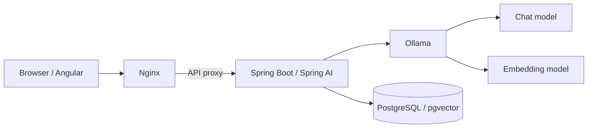

# DocChat Architecture

## Overview

DocChat is a locally hosted PDF assistant built around document-grounded question answering. It combines an Angular frontend, a Spring Boot backend, PostgreSQL with pgvector, and Ollama-hosted language models.

## Components

### Frontend
The Angular application provides PDF upload, processing feedback, document summaries, and the chat workspace. In the containerized setup, Nginx serves the frontend and proxies API requests.

### Backend
The Spring Boot service validates and processes uploaded documents, coordinates summarization and question analysis, retrieves relevant content, and streams chat responses.

### Database and vector store
PostgreSQL stores application/document data. The pgvector extension stores vector representations of document passages and supports similarity search.

### Local AI runtime
Ollama runs the configured chat and embedding models. The default models in the Docker Compose configuration are `llama3.2` and `nomic-embed-text`.

### Container orchestration
Docker Compose coordinates the services and their network, environment configuration, health checks, and persistent volumes.

## Document ingestion

1. **Upload and validation:** the backend checks the upload, including PDF signature, filename handling, and configured size limits.
2. **Text extraction:** text is extracted from the PDF, page by page.
3. **Chunking:** extracted text is split into smaller passages.
4. **Embedding:** the embedding model converts passages into vector representations.
5. **Persistence:** passages and embeddings are stored in PostgreSQL/pgvector.
6. **Summary:** document context is used to generate a summary and key points.

## Question-answering workflow

1. **Question analysis:** the question is classified (for example, overview, specific, vague, or potentially blocked).
2. **Context selection:** depending on document size and implementation settings, the system uses broader context or retrieves passages using vector similarity.
3. **Prompt construction:** the question and selected context are assembled with instructions for grounded answering.
4. **Generation:** the local chat model generates an answer based on the supplied context.
5. **Streaming:** response content is streamed to the frontend.

## RAG

Retrieval-Augmented Generation (RAG) connects a user question to relevant passages from the uploaded document. DocChat embeds document passages and uses vector similarity to select context for the model. This can improve relevance, but it does not guarantee that answers are always correct or that the model will never use outside knowledge.

## Security considerations

- Upload validation and filename sanitization are part of the ingestion flow.
- Nginx configuration is intended to provide security headers and API rate limiting.
- Backend security configuration and prompt defenses provide layers of protection, not guarantees.
- The application currently has no user authentication. It should be used locally and not exposed to untrusted networks.
- PDF text is treated as untrusted input. Prompt-injection detection is pattern-based and can be bypassed.

## Persistence

Docker volumes persist database and Ollama data. Running `docker compose down -v` removes these volumes and their stored data; use this command only when intentionally resetting the environment.

## Further reading

- [API reference](api.md)
- [Main README](../README.md)
- [Security policy](../SECURITY.md)
